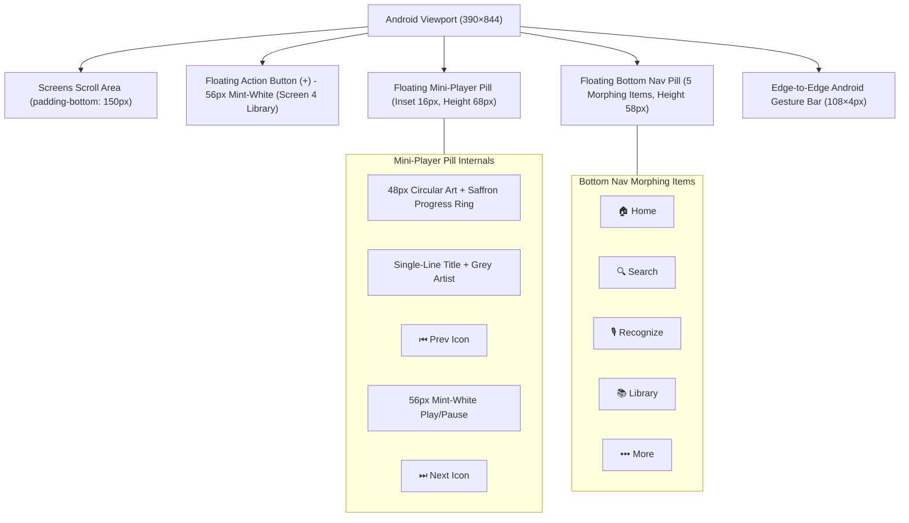
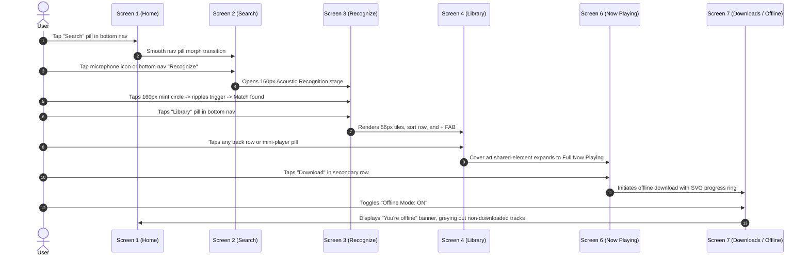

# Kannada Raaga (ಕನ್ನಡ ರಾಗ) — High-Fidelity Mobile Design System & UI Specification

A modern, Android-first (`390×844`, Dark Theme) Material You music streaming application dedicated exclusively to Kannada musical heritage (1934–2026).

---

## 1. Design System Tokens & Style Guide

```
+-------------------------------------------------------------------------------+
| PRIMARY PALETTE (Material You Flat Tonal Surfaces)                            |
| #0B1110   Dark Green-Black Background (Base canvas)                           |
| #18211F   Surface / Cards / Chips / Default Tiles                             |
| #222C29   Elevated Surface (Sheets, Drawers, Floating Containers)             |
| #141C1A   Surface Pill Base                                                   |
| #2A3835   Active Navigation Pill Background                                   |
|                                                                               |
| TYPOGRAPHY & TEXT CONTRAST                                                    |
| #E3EAE6   Primary Text (Headlines, Track Titles, Active Labels)               |
| #8A9490   Secondary Text (Artists, Timestamps, Subtitles, Kickers)            |
|                                                                               |
| ACCENT & HIGHLIGHT COLORS                                                     |
| #DDE6E1   Pale Mint-White Accent (Play buttons, FAB, Recognize trigger)      |
| #0B1110   Dark Ink Glyphs on top of Mint-White surfaces                       |
| #F2A900   Saffron Gold Highlight (Progress rings, active badges, live EQ)     |
+-------------------------------------------------------------------------------+
```

### Typography Scale
- **Fonts**: `Montserrat` (Latin / English metadata) paired with `Noto Sans Kannada` (ಕನ್ನಡ ಲಿಪಿ).
- **Screen Titles**: `28px` Bold (`font-weight: 700; line-height: 1.15`).
- **Section Main Titles**: `18px` Bold (`font-weight: 700`).
- **Card Titles**: `16px` Semibold (`font-weight: 600`).
- **Subtitles & Metadata**: `13px` Regular (`font-weight: 400; color: #8A9490`).
- **Section Kickers**: `12px` Uppercase (`letter-spacing: 1.2px; font-weight: 700`).
- **Now Playing Display**: `22px` Kannada Title (`Noto Sans Kannada 800`) + `15px` Mint Romanized Transliteration.

### Geometry & Elevation Rules
- **Viewport Frame**: Strict Android `390×844` edge-to-edge frame with gesture handle bar (`108×4px`).
- **Corner Radii**:
  - Cards: `20px`
  - Floating pills, FAB, chips: Fully pill-shaped (`999px` / `50%`)
  - Album / Thumbnail Art: `16px` (List thumbs) / `24px` (Now Playing cover)
- **Shadows**: No heavy skeuomorphic drop-shadows. Flat tonal contrast with subtle ambient occlusion (`0 8px 24px rgba(0,0,0,0.4)`).
- **Icons**: Rounded outline `24px`.

---

## 2. Floating Component Hierarchy



---

## 3. Screen-by-Screen Architecture (All 7 Screens)

### SCREEN 1: HOME
- **Top Bar**: "Kannada Raaga" left title (`28px Bold`) + 4 right icons: History (`🕒`), Listening stats (`📊`), Account (`👤`), Settings (`⚙️`).
- **Mood Chips**: Horizontal pill carousel: `Romance`, `Feel good`, `Workout`, `Relax`, `Devotional`, `Folk`, `Sad`. Selected chip fills with `#F2A900` Saffron.
- **Section "FEATURED PLAYLISTS FOR YOU"**: Section header with right arrow `→`. Contains `160×160px` square chart cards with bold title and grey `"Chart"` subtitle.
- **Themed Sections**:
  - `"DANCE YOUR STRESS AWAY / Dancing on Your Own"` (`workout / mass`)
  - `"NINE NIGHTS OF CELEBRATION / Dasara Special"` (`rajyotsava / folk`)
  - `"SOULFUL HERITAGE / Bhavageethe & Dasa Sahitya"` (`devotional / classical`)
- **Bottom Clearance**: Dedicated `150px` scroll clearance ensuring zero overlap with floating controls.

### SCREEN 2: SEARCH
- **Tall Pill Search Bar**: `52px` tall, left search icon (`🔍`), placeholder `"Search Kannada songs..."`, right globe icon (`🌐` linking to A-to-Z browse).
- **Trending Music Videos**: Horizontal row of `180×260px` poster cards with dark bottom gradient, bold white title, and grey artist overlay.
- **Credit Line**: Centered low-contrast badge: `"Data source: Kannada Raaga Licensed Registry • Anand Audio, Lahari, Hombale, PRK & Saregama"`.
- **Typing State**: Recent searches horizontal chip list + Category filter pills: `Songs`, `Albums`, `Artists`, `Playlists`, `Videos`.

### SCREEN 3: RECOGNIZE MUSIC
- **Top Bar**: Back arrow (`←`), title `"Recognize Music"`, right History icon (`🕒`).
- **Acoustic Center**: `160×160px` circular mint-white button (`#DDE6E1`) with dark note glyph (`🎵`), bold `"Tap to recognize"` label below.
- **Listening State**: 3 concentric expanding animated ripple rings with pulsating `"Listening to Kannada melody..."` feedback.
- **Result State**: Recognized card displaying Kannada & English title, movie/year, artist, with 3 immediate action pills: `▶ Play Now`, `＋ Add to Playlist`, `⬇ Download`.

### SCREEN 4: LIBRARY
- **Top Bar**: `"Library"` title + 4 icons (`🕒`, `📊`, `👤`, `⚙️`).
- **Chip Filters**: Horizontal row: `Playlists`, `Songs`, `Albums`, `Artists`, `Local`.
- **Sort Controls**: `"Date added"` pill + square toggle button with up/down arrows (`⇅`).
- **Two-Column 56px Tile Grid**:
  - `♥ Liked`
  - `✓ Downloaded`
  - `📤 Exported`
  - `⚡ Cached`
  - `📈 My top 50`
  - `📉 My bottom 50`
  - `📂 Local`
- **Playlists Section**: Grid of square playlist artwork covers with small check badge and song count.
- **Floating Action Button**: `56px` mint-white circular `+` FAB anchored above the mini-player at bottom-right.

### SCREEN 5: A TO Z BROWSE
- **Kannada Alphabet Grid**: Complete Kannada Varnamale (`ಅ, ಆ, ಇ, ಈ, ಉ, ಊ, ಋ, ಎ, ಏ, ಐ, ಒ, ಓ, ಔ, ಅಂ, ಕ, ಖ, ಗ, ಘ... ಳ`) in rounded `56px` tiles.
- **Script Toggle**: Segmented pill bar switching between `ಕನ್ನಡ ಅ–ಳ` and `English A–Z`.
- **Sticky Letter Header**: Sticky letter badge updating on scroll.
- **Right-Edge Letter Scrubber**: Vertical touch-scrubber bar for instant alphabet jumping.
- **Sort Menu**: Quick sorting by Title (A–Z), Release Year, or Artist.

### SCREEN 6: NOW PLAYING
- **Art Stage**: Immersive large rounded cover (`265px`, `24px` radius) over dynamic blurred gradient background sampled from album art.
- **Bilingual Typography**: Kannada title in bold (`Noto Sans Kannada 20px`), transliteration in mint (`Montserrat 14px`), artist and movie line.
- **Seek Bar**: Interactive scrub bar with live current time and track duration.
- **Transport Bar**:
  - Shuffle icon (`🔀`)
  - Previous track (`⏮`)
  - **72px Mint-White Play/Pause Button** (`#DDE6E1` with `#0B1110` dark glyph)
  - Next track (`⏭`)
  - Repeat mode toggle (`🔁`)
- **Secondary Actions Row**:
  - `♥ Like`
  - `⬇ Download`
  - `☰ Queue`
  - `📝 Lyrics`
  - `🌙 Sleep Timer`
  - `🎛️ 5-Band Equalizer`
- **Synced Lyrics Drawer**: Dual-line Kannada + Romanized subtitles with the active timestamp line illuminated.

### SCREEN 7: DOWNLOADS AND OFFLINE
- **Offline Banner**: Sticky warning `"⚡ You're offline, showing downloaded songs"`.
- **Storage Management Bar**: Visual storage bar displaying `"34.2 MB / 2.0 GB used"` with saffron progress.
- **Controls**: `Wi-Fi Only Toggle` and `Offline Mode Switch (ON / OFF)`.
- **Song Row State**:
  - Per-track SVG circular progress ring during active download
  - Pause / resume control
  - Green checkmark (`✓`) when downloaded
  - Cloud-off icon (`☁️⃠`) with 40% dim opacity for online-only tracks during offline mode.
- **Edge State Previews**: One-tap simulation controls for:
  - Skeleton Loading states
  - Empty states (with musical note illustration)
  - Download Failed (with retry button)
  - Device Storage Full alert.

---

## 4. Clickable Prototype Navigation Flow



---

## 5. Non-Intrusive Audio Ads Architecture & Monetization Engine

### 5.1 Core Design Principle: Zero Visual Clutter
1. **Audio-Only Interstitials**: Audio ads run strictly in the background audio stream **between songs** (15–30 seconds after every 4–5 tracks on the Free Tier).
2. **Never Disruptive**:
   - Ads never interrupt a song mid-track.
   - Ads never pop up full-screen modal takeovers.
   - Ads never cover the mini-player, bottom navigation, search bar, download manager, or settings.
   - Ads never trigger while the user is actively typing or searching.
   - Ads never play back-to-back.

### 5.2 "Ad Playing" Surface States
- **Mini-Player**:
  - Track title replaced with `Ad · Sponsor Name` with amber `AD` badge.
  - Saffron countdown ring displaying remaining duration (e.g., `Ad · 12s`).
  - Seek bar locked; Next/Previous buttons disabled (`opacity: 0.35; pointer-events: none`).
  - Play/Pause and Volume controls remain 100% active.
- **Now Playing Sheet**:
  - Displays high-resolution sponsor creative and campaign tagline (e.g., *Nandini GoodLife*, *Mysore Sandal Soap*, *Karnataka Tourism*).
  - Prominent countdown pill: `Ad · 15s remaining`.
  - Non-intrusive subtle mint-tinted `Remove Ads` link opens the Premium bottom sheet.
- **Lock-Screen / Notification Simulator**:
  - Compact Android MediaStyle notification showing Sponsor art, `AD` badge, countdown timer, and playback controls.

### 5.3 Offline Caching & Impression Telemetry
- Audio ads are pre-fetched during Wi-Fi / active data sessions and stored in a dedicated encrypted cache partition.
- When the user is in **Offline Mode**, cached ads can play between downloaded tracks.
- Impressions and completion events are written to local persistent storage (`indexedDB`/localStorage queue) and securely batched to the telemetry endpoint once network connectivity is restored.
- If no cached ad is available offline or if an ad asset fails to load, the engine **silently skips** directly to the next track with zero delay or user friction.

### 5.4 Privacy & Compliance Controls
- **Ad Preferences Modal**: Explains frequency caps, ad personalization toggles, and privacy disclosures.
- **Under-18 Child Safety (DPDP / GDPR Compliance)**: When the user is identified as under 18, personalized tracking is hard-disabled, reverting strictly to contextual/family-safe brand audio spots.
- **Rewarded Ad Session**: Option to `Watch 1 short audio ad to unlock 60 minutes ad-free`.
- **Premium Plan**: ₹59/month or ₹499/year completely eliminates ads and unlocks lossless FLAC downloads.

---

## 6. Authentication, Login & Sign-Up Flow Architecture

### 6.1 Responsive Layout Adaptations
- **Phone Breakpoint (`360–599px`)**: Single column fluid view with compact branded header (Raaga gold logo, gold filigree gradient accent, tagline *"ಕನ್ನಡ ಹಾಡುಗಳು, ಎಲ್ಲಿಯಾದರೂ"* / *"Kannada songs, anywhere"*), with the form card directly below.
- **Tablet / Landscape Breakpoint (`600px+`)**: Split-screen presentation:
  - **Left Hero Panel**: Cover-art collage of legendary Kannada films (*Gandhadagudi*, *Mayura*, *Kantara*, *KGF*, *Bhakta Prahlada*), dark ambient atmospheric gradient overlay, Kannada calligraphy, and feature highlight pills.
  - **Right Form Panel**: Centered card (`max-width: 440px`) hosting the active multi-step auth workflow.
- **Bilingual Switcher**: Dedicated `ಕನ್ನಡ` / `English` pill button in the top-right of every auth screen, updating all titles, inputs, hints, and error alerts dynamically.

### 6.2 Supported Authentication Flows
1. **Google Single Sign-On (SSO)**:
   - Official Google brand compliance (white pill, `#1F1F1F` typography, official 4-color SVG `G` logo).
   - System Google Account Chooser simulation with account switching and account conflict detection.
2. **Mobile Number + SMS OTP (`+91` Default)**:
   - Searchable country picker sheet featuring India, USA, UK, UAE, Canada, Australia, Singapore, Germany, etc.
   - 10-digit number validation with SMS carrier rate notice.
   - 6-digit auto-advancing code boxes with clipboard paste support and simulated SMS auto-read.
   - 30-second resend cooldown timer and 15-minute lockout security after 3 failed attempts.
3. **Email + 6-Digit Verification Code**:
   - Inline email syntax regex validation with real-time error hints.
   - 6-digit auto-advancing code boxes with backspace auto-retreat.
   - Spam/Junk folder alert displayed after 30 seconds.
4. **Guest Mode**:
   - One-tap browse-only access.
   - Guarded actions (offline downloads and custom playlist creation) display a contextual sign-in prompt modal.
5. **New User Profile Setup**:
   - Avatar icon selection (ಕ, 👑, 🪕, 🎶, 🦁), editable full name, app language preference (ಕನ್ನಡ, English, Both), and *"Keep me signed in"* token persistence.

### 6.3 Account Linking & Edge Cases
- **Account Conflict**: Detecting existing accounts under Google or Phone triggers a prompt: *"This account already exists. Sign in with email to link it"*, followed by credential merge.
- **Offline Guard**: In offline mode, auth warns *"You need internet to sign in. Continue as guest to play downloaded songs"*.
- **Session Management**: Full profile dashboard showing active membership, login provider badge, and a global *"Sign Out of All Devices"* action.
- **Component Sheet & Light Mode**: Complete component specification gallery showcasing pill inputs, code boxes, social buttons, and a global Light Theme variant toggle.


